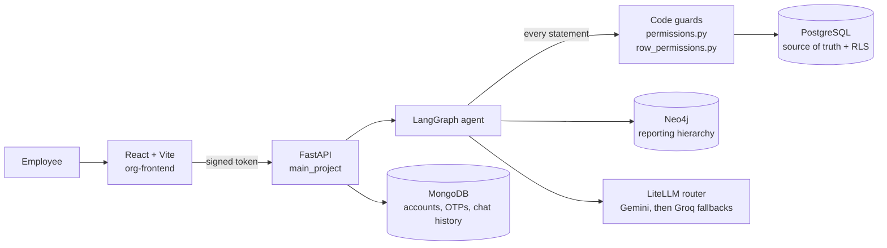
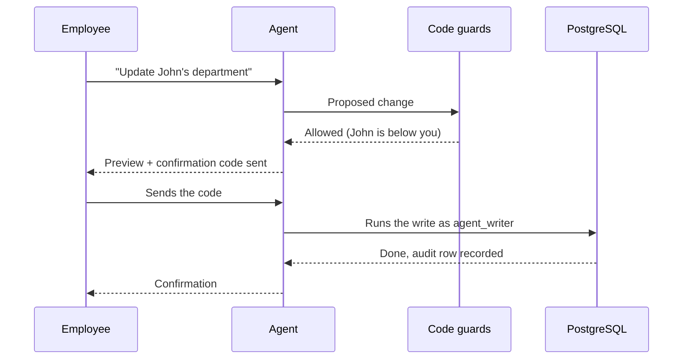

# Company Database Query System

A secured web app where employees chat with an AI agent in plain English to explore, and (within their permissions) change, their company's data. No SQL required.

> "Show all employees in Engineering" · "Who reports to Lisa Hernandez?" · "Update John's department"

The main idea: **the AI is not trusted to enforce security.** Every query passes through code-level guards, and PostgreSQL itself enforces row-level security underneath, so a wrong or manipulated AI answer still cannot read or change data the person is not allowed to touch.

<!-- Add a 1-2 minute demo GIF or screenshot here, for example:  -->

## Highlights

- **Natural-language access** to PostgreSQL data and a Neo4j reporting hierarchy through a LangGraph agent
- **Company-verified sign-up:** only people who exist in the employee records can register, confirmed with an email one-time password (OTP)
- **PostgreSQL row-level security (RLS)** on 15 tables, with three limited database roles
- **Role- and hierarchy-based permissions:** no one can change their own record, and you can only change people below you
- **Every write is previewed and confirmed** with a one-time code, and a change can be undone only by someone who could have made it directly
- **Append-only audit log** of actions and refusals, readable only by HR/admin
- **Login lockout:** repeated failed logins lock the account for 15 minutes
- **Automated security tests:** 225 database checks across all 15 tables, plus privacy, undo, SQL-guard and lockout tests
- **Model fallback chain:** if the primary Gemini model fails, the agent falls back to other Gemini and Groq models

## Architecture



| Layer | Technology |
| --- | --- |
| Frontend | React, Vite, Redux |
| Backend | FastAPI, Python 3.13 |
| Employee data (source of truth) | PostgreSQL |
| Org hierarchy | Neo4j |
| Accounts, OTPs, chat history | MongoDB |
| AI | LangChain / LangGraph, LiteLLM (Gemini first, Groq fallbacks) |
| Observability | Langfuse (optional) |

## How a request is handled

1. The employee signs in, and the backend turns their signed token into their **verified PostgreSQL employee ID**. The ID never comes from the chat text.
2. The agent turns the question into a SQL query or a graph query.
3. **Code guards** check every statement. Comments, multiple statements, schema changes, deletes and writes to the `users` table are refused, along with rule violations such as approving your own request.
4. **PostgreSQL** runs the query under a limited role, and row-level security filters the rows that role may see.
5. For changes, the agent shows a **preview** first. The change runs only after the person sends back the one-time code.
6. The action, or the refusal, is written to the **audit log**.



## Security model

Security is layered so that no single layer, including the AI, is a single point of failure.

| Layer | What it enforces |
| --- | --- |
| Sign-up | Name, employee ID and department must match the PostgreSQL record, then an email OTP confirms the address |
| Sessions | JWT tokens, and the app refuses to start without a strong `JWT_SECRET` (32+ characters) |
| Login lockout | Repeated failed logins lock the account for 15 minutes |
| Code guards (`permissions.py`, `row_permissions.py`) | Blocks comments, multiple statements, schema changes, deletes and writes to `users`. Applies rules like "nobody approves their own request" and "you can only change people below you" |
| Database roles | `agent_reader` (reads), `agent_writer` (writes) and `app_agent` (backend). No chat role can delete rows or touch the admin flag |
| Row-level security | A company wall on 15 tables keeps companies apart |
| Privacy rule | Everyone can see colleagues' names, departments and roles. Email and manager are visible only to the person, their managers and HR/admins |
| Writes | Preview, then a one-time code on every change. Undo is allowed only for someone who could have made the change directly |
| Audit log | Records actions and refusals, is append-only for the application and chat roles, and is readable only by HR/admin. `purge_audit.py` removes old records under a separate low-privilege database user |
| Limits | Statement timeout and a large-write threshold on database operations |
| Secrets | Kept in `.env` files, which are git-ignored |

## Project structure

```
main_project/        FastAPI backend, agent, auth, permissions, DB scripts
  main.py            App entry point
  auth.py            Token and password handling
  auth_routes.py     Sign-up, OTP, login, password reset
  agent.py           LangGraph agent and model fallback
  mcp_tools.py       Tools the agent can call
  permissions.py     Statement guard
  row_permissions.py Row and hierarchy rules
  sync_neo4j.py      Syncs the org hierarchy from PostgreSQL to Neo4j
  purge_audit.py     Deletes old audit records
  routes/            API routes (profile, user)
  *.sql              Roles, RLS policies and fixes
org-frontend/        React + Vite frontend
```

## Getting started

### Prerequisites

- Python 3.13
- Node.js (current LTS)
- PostgreSQL, MongoDB and Neo4j, running locally or hosted
- API keys for Gemini and/or Groq
- An SMTP account for sending OTP emails

### 1. Backend

```bash
cd main_project
python -m venv venv
venv\Scripts\activate          # Windows
# source venv/bin/activate     # macOS / Linux
pip install -r requirements.txt
```

Copy the environment template and fill in your values:

```bash
copy .env.example .env         # Windows
# cp .env.example .env         # macOS / Linux
```

Generate a JWT secret and paste it into `.env`:

```bash
python -c "import secrets; print(secrets.token_urlsafe(48))"
```

Set up the databases:

1. Create the PostgreSQL database named in `POSTGRES_DB` and load your employee schema. The `*.sql` files in this folder add the privacy roles, RLS policies and fixes on top of it.
2. Sync the org hierarchy into Neo4j:

```bash
python sync_neo4j.py
```

Start the API:

```bash
uvicorn main:app --reload --port 4000
```

### 2. Frontend

```bash
cd org-frontend
copy .env.example .env         # Windows
# cp .env.example .env         # macOS / Linux
npm install
npm run dev
```

Open http://localhost:5173.

## Environment variables

See `main_project/.env.example` and `org-frontend/.env.example` for the full list.

| Group | Variables |
| --- | --- |
| LLM | `GEMINI_API_KEY`, `GROQ_API_KEY`, `PRIMARY_MODEL`, `FALLBACK_MODEL_1..4` |
| Auth | `JWT_SECRET`, `JWT_EXPIRES_MINUTES` |
| Email | `SMTP_HOST`, `SMTP_PORT`, `SMTP_USER`, `SMTP_PASSWORD` |
| PostgreSQL | `POSTGRES_*`, `DATABASE_URL` |
| MongoDB | `MONGODB_URI`, `MONGODB_DB_NAME` |
| Neo4j | `NEO4J_URI`, `NEO4J_USER`, `NEO4J_PASSWORD` |
| Frontend | `VITE_API_URL`, `VITE_BASE_URL` |

Never commit your real `.env` files.

## Tests

The security rules are checked automatically. Run these **against a development database only**.

| Test | What it covers |
| --- | --- |
| `test_tables.sql` | 225 database checks across all 15 tables: RLS, roles and what each role can and cannot do |
| `test_guards.py` | 21 cases for the SQL guard (comments, multiple statements, schema changes, deletes, `users` writes) |
| `test_row_rules.py` | 59 checks for the privacy and row rules |
| `test_revert_rules.py` | 10 checks for the undo rule |
| `test_permissions1.py` | Role and hierarchy permissions |
| `test_login_lockout.py` | 15-minute lockout after repeated failed logins |

```bash
python test_login_lockout.py
```

## Limitations

- This is a student project. It has not had an independent security audit, so review it before using it with real company data.
- The tests need a development database with the employee schema loaded.
- Model answers depend on the LLM providers' availability, so the fallback chain reduces failures but cannot remove them.

## Author

Built by **Muskan**, B.Tech Information Technology, IIIT Una.
